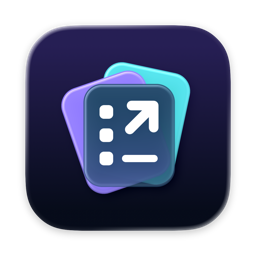

# SK's App Menu



A native macOS menu-bar and Dock application launcher. Find applications inside vendor subfolders, organize them into categories, and launch the exact installed copy you choose.

**Requires macOS 27.0+ and Apple silicon.** Built with Swift 6, SwiftUI and AppKit, with no third-party runtime dependencies.

## Features

- Recursive discovery in `/Applications`, `/System/Applications` and `~/Applications`, including Adobe and DaVinci vendor folders.
- Native menu-bar categories with application icons and compact labels.
- Optional categorized Dock grid with Compact, Comfortable and Spacious sizes, search and keyboard navigation.
- Browse/Add apps elsewhere; hide/restore apps and change their categories persistently.
- Right-click grid hiding; Uninstall-named apps hidden by default, with explicit restoration remembered.
- iOS-on-Mac application classification, missing-app reconnection, local backups and protected recovery.
- Original layered Liquid Glass icon, dark appearance support and a bundled user guide.

## Download and install

Download the DMG from [Releases](https://github.com/siveesh/sks-app-menu/releases), open it, drag **SK's App Menu.app** to **Applications**, eject the image and launch the installed copy. Click its menu-bar grid icon to get started. Choose **Show in Dock** for the optional grid window.

**Release status:** the public DMG is Developer ID-signed by Siveesh Kodapully with Hardened Runtime, but **not notarized**. Notarization was explicitly deferred for this release. Gatekeeper may block a downloaded copy; do not disable Gatekeeper or strip quarantine to work around it. See [notarization setup](docs/Notarization.md) for the maintainer workflow.

### Homebrew tap

```bash
brew tap siveesh/tap
brew trust --cask siveesh/tap/sks-app-menu
brew install --cask siveesh/tap/sks-app-menu
```

For Homebrew 7, review the cask before trusting this specific definition; this does not bypass Gatekeeper. Older Homebrew may not have the trust command.

This is the project's own tap, not an official `homebrew/cask` listing. The cask has the same unnotarized-release limitation. [Homebrew support and eligibility](docs/Homebrew.md) explains validation results and upstream requirements.

## User documentation

Read the complete [Help.md](Help.md) for every window, menu, toolbar, shortcut and recovery workflow. The same guide is bundled with the app and disk image. In the app, use **Help → SK's App Menu Help**, menu-bar **Help**, or the management toolbar's Help button. The guide's **Contents** menu jumps between topics.

[Installation and updates](INSTALL.md) · [Changelog](CHANGELOG.md) · [Report a problem](https://github.com/siveesh/sks-app-menu/issues)

## Privacy and preferences

No accounts, analytics, cloud synchronization or network service are used by the app. Its catalog stays in `~/Library/Application Support/com.siveesh.sksappmenu/`. Hiding and recategorizing modify only launcher preferences; installed application bundles are never edited or deleted. Normal app removal retains preferences.

## Build and test

Use Xcode 27+ with the macOS 27 SDK on an Apple silicon Mac running macOS 27+. The development verification host uses Xcode 27.2 / Swift 6.4.2 and macOS 27.2.1. The earliest supported runtime, macOS 27.0, still needs separate qualification.

```bash
./script/build_and_run.sh --verify
./scripts/test.sh
swift test
python3 scripts/verify_governance.py --strict --phase documentation
```

The checked-in Xcode project builds without a generator. If you change the project specification or add files, regenerate with `xcodegen generate` and commit both `project.yml` and the project. Test hosts use an isolated catalog; never replace normal preferences with QA data. Do not run simultaneous Xcode commands against the same DerivedData directory. Build products, logs, DMGs and local catalogs are ignored by Git.

For an isolated manual run, pass `--store-directory /absolute/test/directory` after `--verify`. `--manage` explicitly opens management for testing; ordinary startup leaves it closed. These options are for development and are not needed by users.

## Release workflow

```bash
SK_APP_MENU_SIGNING_IDENTITY="Developer ID Application: Name (TEAMID)" \
  ./scripts/package.sh 1.3.0-arm64
```

The script creates a signed DMG containing the app, Applications link, user guide, installation instructions and license. It refuses to overwrite an existing artifact and does not notarize. Without a signing identity it produces an ad-hoc local build, which is unsuitable as a normal public-download release. See [release instructions](docs/Distribution.md) and the separate [notarization guide](docs/Notarization.md).

## Repository layout

`Sources/Core` holds discovery, classification, identity, visibility and persistence. `Sources/App` holds the model, native UI and menu/window bridges. `Tests` covers core and hosted app behavior. `Resources` contains native assets; the root `Help.md` is the canonical bundled guide. `Casks` holds the release cask mirrored to the owner tap. `docs` contains user-support and maintainer records, while `.github` holds repository workflows and issue guidance.

## Contributing and license

Contributions are welcome; start with [CONTRIBUTING.md](CONTRIBUTING.md). For sensitive reports, use [SECURITY.md](SECURITY.md).

Copyright © 2026 Siveesh Kodapully. Licensed under the [MIT License](LICENSE). This is an independent native rebuild inspired by [app-menu](https://github.com/barseghyanartur/app-menu/); no upstream code or assets were imported. The developer identity assets belong to the project owner.
